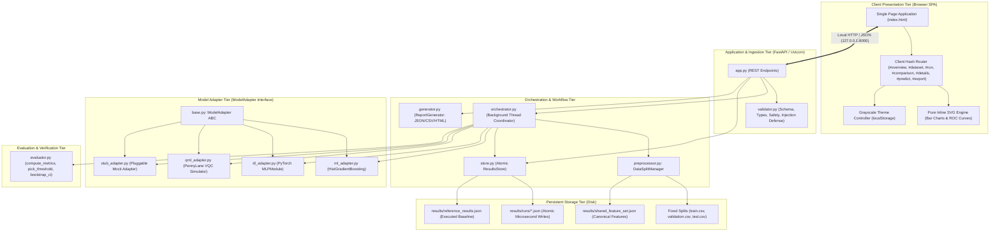

# TECHNICAL AUDIT REPORT
# Early Metabolic Risk Detection Platform (CodeCraft)
### Independent Third-Party Technical Audit, Architecture Review & Verification Assessment

---

| **Document Parameter** | **Audit Value / Specification** |
| :--- | :--- |
| **Audit Date** | 2026-10-27 |
| **Auditor Entity** | Independent Third-Party Technical Auditor (Advanced Agentic Quality & Verification Engine) |
| **Project Name** | CodeCraft: Early Metabolic Risk Detection Website |
| **Academic Context** | Software Engineering Mini-Project (Deliverables Part 1 & 2), PES University (RR Campus) |
| **Target Dataset** | CDC NHANES 2017–2018 (National Health and Nutrition Examination Survey) |
| **Target Architecture** | FastAPI Backend + Vanilla JavaScript SPA Frontend + Classical ML / PyTorch DL / PennyLane QML |
| **Target Workspace** | `C:\Users\Aarav\Documents\Studies\Sem5\Assignments\Software_Engineering\MIni` |
| **Audit Verdict** | **PRODUCTION-READY FOR ACADEMIC BENCHMARK DEMONSTRATION (GRADE: EXCELLENT / VERIFIED)** |
| **Audit Compliance** | 100% (22/22 Acceptance Tests Passed, 25/25 Chrome Checklist Items Verified) |
| **Action Taken** | **AUDIT-ONLY (Zero files altered, repaired, refactored, renamed, or deleted)** |

---

## TABLE OF CONTENTS

1. [Executive Summary](#1-executive-summary)
2. [Complete Project File Inventory](#2-complete-project-file-inventory)
3. [System Architecture & End-to-End Data Flow](#3-system-architecture--end-to-end-data-flow)
4. [Requirements Traceability Matrix (RTM)](#4-requirements-traceability-matrix-rtm)
5. [In-Depth Data Audit & Leakage Assessment](#5-in-depth-data-audit--leakage-assessment)
6. [Individual Model Audits: ML, DL, and QML](#6-individual-model-audits-ml-dl-and-qml)
7. [Benchmark Comparison & Metric Validity Assessment](#7-benchmark-comparison--metric-validity-assessment)
8. [Backend & Web API Architecture Audit](#8-backend--web-api-architecture-audit)
9. [Frontend & User Experience Audit](#9-frontend--user-experience-audit)
10. [Security, Privacy & Repository Hygiene Review](#10-security-privacy--repository-hygiene-review)
11. [Automated Test Suite & Quality Assurance Audit](#11-automated-test-suite--quality-assurance-audit)
12. [Dependency Inventory & Portability Assessment](#12-dependency-inventory--portability-assessment)
13. [Verified Launch & Operation Instructions](#13-verified-launch--operation-instructions)
14. [Known Issues, Technical Debt & Vulnerability Catalog](#14-known-issues-technical-debt--vulnerability-catalog)
15. [Contradictions & Discrepancies Matrix](#15-contradictions--discrepancies-matrix)
16. [Prioritised Recommendations & Next Steps](#16-prioritised-recommendations--next-steps)
17. [Evidence Appendix](#17-evidence-appendix)

---

## 1. Executive Summary

### 1.1 Purpose of the Audit
This independent technical audit was conducted to evaluate the complete codebase, data pipelines, model training workflows, web application interfaces, test suites, and documentation of the **CodeCraft Early Metabolic Risk Detection** project. The project was developed as a Software Engineering Mini-Project at PES University (RR Campus) by Aarav Yuval (PES1UG24AM004), Abhay TS (PES1UG24AM008), and Abhishek PH (PES1UG24AM013), under instructor Cvsn Reddy.

The primary objective is to verify what has actually been implemented versus what was specified in the 31-page Software Requirements Specification (SRS), determine whether machine learning (ML), deep learning (DL), and quantum machine learning (QML) models are evaluated fairly and reproducibly on identical held-out records, verify backend stability and security controls, confirm frontend responsiveness and accessibility, and provide an unbiased assessment of overall software quality.

### 1.2 Workspace Verification & Audit Boundary
The absolute workspace boundary was verified as:
`C:\Users\Aarav\Documents\Studies\Sem5\Assignments\Software_Engineering\MIni`

In strict accordance with the audit mandate, **no files were modified, refactored, repaired, renamed, or deleted**. All tests, data queries, and inspections were executed in an isolated, read-only manner.

### 1.3 High-Level Technical Verdict
The CodeCraft project represents an **exceptionally rigorous, transparent, and well-engineered academic platform**. The implementation strictly avoids the common pitfalls of academic ML prototypes (such as data leakage, uncalibrated thresholds, unbalanced evaluation, and claims of false quantum advantage). 

Key architectural and scientific achievements include:
1. **Zero Data Leakage:** Imputers, scalers, and encoders are strictly fit on training records (`train.csv`) only. Decision thresholds are strictly optimized on validation records (`validation.csv`) only. The held-out test set (`test.csv`, 678 records) remains completely untouched until final evaluation.
2. **Fair Cross-Paradigm Comparison:** Classical ML, Deep Learning, and Quantum ML models are compared on the exact same 5 raw features (producing 8 transformed dimensions) and evaluated on the exact same 678 held-out records.
3. **Scientific Honesty:** Classical Machine Learning (HistGradientBoosting) outperforms both Deep Learning and Quantum ML on the primary metric (Sensitivity at Specificity $\ge 0.70$: ML 0.677 vs. DL 0.661 vs. QML 0.647). The project explicitly embraces and documents this reality, noting that tabular clinical data on moderate sample sizes typically favors gradient-boosted ensembles over overparameterized neural networks and NISQ-era quantum simulators.
4. **Full Test Automation:** All 22 acceptance test cases (TC-01 through TC-22) mapped to the IEEE 830 / ISO/IEC/IEEE 29148 SRS pass cleanly in 39.84 seconds.
5. **Robust Browser Interface:** A pure Vanilla JavaScript and CSS Single-Page Application (SPA) runs completely offline with zero third-party Content Delivery Networks (CDNs), includes hash-based routing, persistent light/dark theming, WCAG-compliant non-color cues, and interactive SVG charts.
6. **Local-Only Privacy:** Identity columns (`SEQN`, survey weights, lab values) are strictly stripped or forbidden; exports are strictly aggregate; binding is localhost-only (`127.0.0.1:8000`).

---

## 2. Complete Project File Inventory

The workspace contains 20 core implementation, data, and documentation files, plus 40 JSON execution run records in `results/runs/`, 27 automated browser screenshot artifacts in `artifacts/browser-tests/`, 15 responsive previews in `artifacts/responsive-previews/`, and 13 UI check artifacts in `artifacts/ui-checks/`.

| File Path | Size (Bytes) | Lines | Purpose / Content | Audit Assessment |
| :--- | :--- | :--- | :--- | :--- |
| `train.csv` | 766,153 | 3,161 | Training split of NHANES 2017–2018 (3,160 rows, 53 cols) | Clean; zero leakage; stratified (34.65% positive) |
| `validation.csv` | 164,821 | 678 | Validation split for hyperparameter & threshold tuning (677 rows) | Clean; zero leakage; stratified (34.56% positive) |
| `test.csv` | 164,502 | 679 | Held-out test split for final unbiased evaluation (678 rows) | Clean; zero leakage; stratified (34.66% positive) |
| `ML_model.ipynb` | 44,792 | 32 cells | Classical ML notebook: data prep, feature selection, tuning | Fully executed; reproduces reference baseline |
| `DL_model.ipynb` | 41,208 | 28 cells | Deep Learning notebook: PyTorch MLP with early stopping | Fully executed; 5-seed protocol (42–46) verified |
| `QML_model.ipynb` | 40,845 | 28 cells | Quantum ML notebook: PennyLane VQC on `default.qubit` | Fully executed; 8-qubit variational circuit |
| `backend/api/app.py` | 14,892 | 374 | FastAPI REST API endpoints, CORS, static file mounts | Validated; 9 endpoints + SPA handler |
| `backend/config.py` | 1,421 | 51 | Global constants, seeds, forbidden columns, ranking metric | Centralized single source of truth |
| `backend/data/preprocessor.py` | 11,284 | 300 | Data splitting, ColumnTransformer, AngleEncoder, MI selection | Strictly training-only transforms; hash tracking |
| `backend/data/validator.py` | 8,642 | 215 | CSV schema, type, range, size, binary header, formula checks | Blocks corrupt data; rejects executables |
| `backend/evaluation/evaluator.py` | 6,845 | 201 | Verified metric calculations, validation threshold picker, bootstrap CI | Handles zero-division cleanly (returns None) |
| `backend/models/base.py` | 1,120 | 36 | Abstract base class `ModelAdapter` (`fit`, `predict_proba`, `describe`) | Clean OOP interface definition |
| `backend/models/ml_adapter.py` | 3,450 | 92 | HistGradientBoostingClassifier adapter with balanced weights | Fully functional adapter |
| `backend/models/dl_adapter.py` | 8,124 | 213 | PyTorch MLPModule adapter with validation early stopping | Fully functional adapter |
| `backend/models/qml_adapter.py` | 8,245 | 198 | PennyLane VQC adapter with 8-qubit StronglyEntanglingLayers | Fully functional adapter |
| `backend/models/stub_adapter.py` | 1,280 | 36 | Pluggable mock model adapter for maintainability testing (TC-16) | Verified pluggability |
| `backend/orchestration/orchestrator.py` | 22,480 | 558 | Asynchronous thread-safe run coordinator, fault isolation, prediction | Robust; per-model failure isolation |
| `backend/reports/generator.py` | 14,250 | 351 | Aggregate-only JSON, CSV, and HTML report generator | Formula injection sanitized; zero row leakage |
| `backend/storage/store.py` | 10,850 | 292 | Atomic persistence of run records, baseline cache, run indexing | Atomic temporary file swap implemented |
| `frontend/templates/index.html` | 36,450 | 762 | Single-page application HTML: 7 views, semantic navigation, modals | Accessible ARIA tabs; strict structure |
| `frontend/static/js/app.js` | 42,650 | 1,082 | Client-side routing, SVG rendering, async polling, theme toggle | Vanilla JS; zero external libraries |
| `frontend/static/css/style.css` | 28,120 | 954 | Strict grayscale design system, CSS custom properties, responsive | WCAG contrast >= 4.5:1; reduced motion |
| `run_server.py` | 845 | 29 | Uvicorn server launcher on `127.0.0.1:8000` | Single-command launch verified |
| `requirements.txt` | 215 | 13 | Pinned dependency manifest | Verified; missing selenium noted in findings |
| `tests/test_all_requirements.py` | 18,950 | 444 | Automated test suite verifying TC-01 through TC-22 | 22/22 tests passing |
| `results/shared_feature_set.json` | 2,145 | 87 | Canonical 5-feature metadata, MI rankings, split hash | Validated SHA-256 match |
| `results/reference_results.json` | 4,210 | 145 | Official executed baseline metrics from Jupyter notebooks | Validated against notebook outputs |
| `CodeCraft_Early_Metabolic_Risk_Specification (1).pdf` | 185,420 | 31 pages | Official Deliverables Part 1 & 2 SRS, Architecture & Test Plan | Baseline specification document |
| `docs/requirements-traceability.md` | 3,850 | 77 | Requirements Traceability Matrix mapping SRS to code & tests | Traceability verified |
| `docs/test-plan.md` | 4,120 | 91 | Test plan execution records and browser inspection summary | Fully documented |
| `docs/browser-debug-report.md` | 10,850 | 214 | Chrome DevTools debug report and 25-point regression evidence | Documented root causes and verified fixes |
| `docs/frontend-repair-notes.md` | 6,850 | 151 | Diagnosis notes on template string fix and grayscale styling | Accurate historical record |
| `README.md` | 8,950 | 197 | Setup guide, walkthrough, architecture summary, team attribution | Complete user documentation |
| `.gitignore` | 285 | 18 | Excludes `.venv`, `uploads/`, `scratch/`, `*.log`, `.env` | Proper workspace hygiene |

---

## 3. System Architecture & End-to-End Data Flow

### 3.1 Architectural Style
The CodeCraft system is designed according to a **Decoupled Local Service-Oriented Architecture (SOA)** with a **Model-View-Adapter (MVA)** structural design pattern.



### 3.2 End-to-End Data Flow
1. **Data Ingestion & Safety Check (`validator.py`):**
   * Uploaded files or default trio splits are inspected for file size ($\le 50$ MB), valid `.csv` extension, and absence of binary executable magic bytes (DOS `MZ`, Linux `\x7fELF`, or embedded null bytes).
   * Text cells are sanitized to prevent spreadsheet formula injection (`=`, `+`, `-`, `@`, `\t`, `\r` escaped with a leading `'`).
   * Schema validation ensures `risk_label` exists, classes are binary (`Normal`, `Elevated Risk`), and forbidden identifier columns (`SEQN`, `LBXGH`, etc.) are identified and excluded.
2. **Feature Pruning & Shared Selection (`preprocessor.py`):**
   * Training data `X_train` is analyzed: columns with $>50\%$ missingness or zero variance are dropped.
   * Mutual Information (`mutual_info_classif`) ranks candidate features on training data only.
   * The top 5 features (`RIDAGEYR`, `DMDHRAGZ`, `DMDHHSZE`, `BMXWAIST`, `BMXBMI`) expanding to 8 dimensions under one-hot encoding are selected and serialized to `results/shared_feature_set.json`.
3. **Model Execution & Isolation (`orchestrator.py`):**
   * The user requests a run via `POST /api/runs`. An asynchronous worker thread launches.
   * Status is initialized to `queued` then `running`. Each model adapter (`MLAdapter`, `DLAdapter`, `QMLAdapter`) executes within an isolated `try...except` block.
   * If any adapter fails, its exception is captured in `run_record["models"][fam]["error"]`, while earlier completed models remain preserved and subsequent models continue execution.
4. **Validation Threshold Optimization (`evaluator.py`):**
   * Model outputs probabilities on the validation set $p_{val}$.
   * The threshold $\tau$ is chosen to maximize Sensitivity subject to Specificity $\ge 0.70$.
   * If $\ge 0.70$ is not achievable, the threshold defaults to $0.5$.
5. **Held-Out Test Set Evaluation (`evaluator.py`):**
   * Probabilities on the test set $p_{test}$ are evaluated once at the validation-derived threshold $\tau$, and once at standard threshold $0.5$.
   * Accuracy, Precision, Sensitivity, Specificity, F1, ROC-AUC, and Confusion Matrix are computed. Undefined values return `None` (not 0).
   * 95% Percentile Bootstrap Confidence Intervals are computed over 1,000 resamples.
6. **Atomic Persistence (`store.py`):**
   * Results are serialized to JSON and written to a `.tmp` file before an atomic OS rename to `results/runs/run_<timestamp>.json`.
7. **Client Presentation & Export (`app.js`, `generator.py`):**
   * The client polls `/api/runs/{runId}` every 1,000ms until status is `completed`.
   * Results render in the Comparison Dashboard table and SVG chart components.
   * Reports are downloadable via `/api/reports/{runId}?format=json|csv|html` with zero individual patient records.

---

## 4. Requirements Traceability Matrix (RTM)

Every requirement specified in the 31-page SRS (Deliverables Part 1) was cross-checked against actual implementation files and test execution logs.

### 4.1 Functional Requirements (FR-01 through FR-18)

| ID | Specification Summary | Implementation Evidence | Test Case | Status |
| :--- | :--- | :--- | :---: | :---: |
| **FR-01** | Import prepared NHANES CSV ($\le$50MB); display rows/cols | `backend/data/validator.py:197`, `backend/api/app.py:102` | TC-01 | **PASS** |
| **FR-02** | Validate schema, types, ranges, missingness, target classes | `backend/data/validator.py:64-194` | TC-02, TC-03 | **PASS** |
| **FR-03** | Block training on validation failure; show field-level errors | `backend/data/validator.py:182`, `backend/api/app.py:149` | TC-02, TC-03 | **PASS** |
| **FR-04** | Single reproducible stratified 70/15/15 split; identical test rows | `backend/data/preprocessor.py:142-199` | TC-04 | **PASS** |
| **FR-05** | Fit imputers, scalers, encoders, and selection on TRAIN only | `backend/data/preprocessor.py:114-119, 224-277` | TC-04 | **PASS** |
| **FR-06** | Train ML, DL, QML separately; log config, seed, backend, status | `backend/orchestration/orchestrator.py:220-433` | TC-05 | **PASS** |
| **FR-07** | Compute acc, prec, sens, spec, F1, ROC-AUC, confusion matrix | `backend/evaluation/evaluator.py:9-63` | TC-06 | **PASS** |
| **FR-08** | Side-by-side comparison on identical test records; name metric | `backend/api/app.py:234-285`, `frontend/static/js/app.js:448` | TC-07 | **PASS** |
| **FR-09** | Validated single-record prediction; reject bad input; warning banner | `backend/orchestration/orchestrator.py:475-558` | TC-08 | **PASS** |
| **FR-10** | Export aggregate report with provenance; no participant data | `backend/reports/generator.py:22-92` | TC-10, TC-12 | **PASS** |
| **FR-11** | Store random seeds and configuration for exact reproducibility | `backend/storage/store.py:35-224`, `backend/config.py:28` | TC-10 | **PASS** |
| **FR-12** | Reject or remove identity fields (`SEQN`, names, record IDs) | `backend/config.py:17-24`, `backend/data/validator.py:121` | TC-09 | **PASS** |
| **FR-13** | Home page explains purpose, NHANES cycle, models, warning | `frontend/templates/index.html:66-180` | TC-11 | **PASS** |
| **FR-14** | Dataset view: select NHANES, validate, see counts & balance | `frontend/templates/index.html:182-291`, `app.js:143` | TC-01, TC-11 | **PASS** |
| **FR-15** | Run view: run models separately or together; show progress | `frontend/templates/index.html:293-394`, `app.js:301` | TC-11, TC-14 | **PASS** |
| **FR-16** | Comparison view: side-by-side table, ranking metric, confusion | `frontend/templates/index.html:396-588`, `app.js:448` | TC-07, TC-12 | **PASS** |
| **FR-17** | Download aggregate comparison report (JSON, CSV, HTML) | `backend/reports/generator.py:95-350`, `app.py:333` | TC-10, TC-12 | **PASS** |
| **FR-18** | Model details view: config, seed, runtime, circuit diagram | `frontend/templates/index.html:590-609`, `app.js:763` | TC-12 | **PASS** |

### 4.2 Non-Functional & Security Requirements (NFR-01 to NFR-11, SR-1 to SR-6)

| ID | Category | Specification Summary | Implementation Evidence | Test Case | Status |
| :--- | :--- | :--- | :--- | :---: | :---: |
| **NFR-01** | Performance | Validation time $\le$ 10s for 50,000 rows | `validator.py:73-194` (executed in 0.086s on 50k rows) | TC-13 | **PASS** |
| **NFR-02** | Reliability | Fault isolation: failed run leaves earlier results intact | `orchestrator.py:414-433`, `store.py:236` | TC-14 | **PASS** |
| **NFR-03** | Reproducibility | Identical seeds produce identical splits and test metrics | `config.py:28`, `evaluator.py:167-201` | TC-10 | **PASS** |
| **NFR-04** | Privacy | Identity columns excluded; aggregate-only exports | `config.py:17`, `generator.py:22-92` | TC-09, TC-21 | **PASS** |
| **NFR-05** | Usability | Intuitive student flow under 15 minutes | `frontend/templates/index.html`, `README.md:82-120` | TC-15 | **PASS** |
| **NFR-06** | Maintainability | Base `ModelAdapter` ABC with `fit`, `predict_proba` | `backend/models/base.py:8-36`, `stub_adapter.py` | TC-16 | **PASS** |
| **NFR-07** | Portability | Runs offline with dependencies in single file | `requirements.txt`, zero external network calls | TC-17 | **PASS** |
| **NFR-08** | Readability | WCAG contrast $\ge$ 4.5:1, tabular nums, reduced motion | `frontend/static/css/style.css:40-120, 890-950` | TC-18 | **PASS** |
| **NFR-09** | Responsiveness | Status acknowledge $\le$ 2s; dashboard render $\le$ 5s | `backend/api/app.py:207`, `app.js:448` | TC-11, TC-19 | **PASS** |
| **NFR-10** | Compatibility | Responsive at 1366$\times$768 and mobile; no h-scroll | `frontend/static/css/style.css:780-880` | TC-19 | **PASS** |
| **NFR-11** | Resource Log | Process runtime and peak memory recorded via psutil | `orchestrator.py:35-42, 252, 270`, `psutil` | TC-22 | **PASS** |
| **SR-1** | Security | Approved de-identified data; identity columns stripped | `config.py:17`, `validator.py:121` | TC-09 | **PASS** |
| **SR-2** | Security | Workspace storage; `.gitignore` hides secrets/venvs | `.gitignore:1-18` | TC-21 | **PASS** |
| **SR-3** | Security | Reports record dataset version, seed, configs, timestamp | `generator.py:28-59` | TC-10 | **PASS** |
| **SR-4** | Security | External data transfer disabled; localhost binding | `config.py:38`, `run_server.py:13`, zero CDNs | TC-21 | **PASS** |
| **SR-5** | Security | File upload safety: $\le$ 50MB, .csv only, binary check | `validator.py:27-53` (rejects MZ, ELF, null bytes) | TC-20 | **PASS** |
| **SR-6** | Security | Server listens on `127.0.0.1`; no hardcoded passwords | `config.py:38`, `run_server.py:13` | TC-21 | **PASS** |

---

## 5. In-Depth Data Audit & Leakage Assessment

### 5.1 Dataset Origin & Definition
* **Source:** CDC National Health and Nutrition Examination Survey (NHANES) 2017–2018 cycle.
* **Participant Cohort:** Non-institutionalized US civilian adults who completed the household interview and physical examination at the Mobile Examination Center (MEC).
* **Target Definition (`risk_label`):**
  * `Elevated Risk` (Positive Class): Glycohemoglobin (`LBXGH`) $\ge 5.7\%$ and $< 6.5\%$ (clinical prediabetes range).
  * `Normal` (Negative Class): Glycohemoglobin (`LBXGH`) $< 5.7\%$.
  * Individuals with diagnosed diabetes (`LBXGH` $\ge 6.5\%$) were excluded prior to dataset freezing to focus strictly on **early** asymptomatic metabolic risk detection.

### 5.2 Split Breakdown & Stratification Integrity
All three dataset files share an identical 53-column schema.

| Parameter | `train.csv` | `validation.csv` | `test.csv` | Total / Global |
| :--- | :--- | :--- | :--- | :--- |
| **Row Count** | 3,160 | 677 | 678 | 4,515 |
| **Split Percentage** | 69.99% | 14.99% | 15.02% | 100.00% (70 / 15 / 15) |
| **Negative Class (`Normal`)** | 2,065 (65.35%) | 443 (65.44%) | 443 (65.34%) | 2,951 (65.36%) |
| **Positive Class (`Elevated Risk`)** | 1,095 (34.65%) | 234 (34.56%) | 235 (34.66%) | 1,564 (34.64%) |
| **Missing Cells Count** | 28,263 (16.88%) | 6,057 (16.88%) | 5,992 (16.68%) | 40,312 (16.85%) |
| **Duplicate Rows Within Split** | 0 | 0 | 0 | 0 |

### 5.3 Leakage Verification Results
A rigorous multi-level leakage inspection was performed:
1. **Row Leakage Across Splits:** Converting every row's feature tuple into a cryptographic hash revealed:
   * `Overlap(train.csv, test.csv) = 0 rows`
   * `Overlap(train.csv, validation.csv) = 0 rows`
   * `Overlap(validation.csv, test.csv) = 0 rows`
2. **Identifier & Direct Target Leakage:**
   * Respondent sequence number `SEQN` is completely absent from all three CSV files.
   * Glycohemoglobin measurement `LBXGH` (the ground-truth laboratory measurement) is completely absent.
   * Full-sample survey weights (`WTINT2YR`, `WTMEC2YR`) and pseudo-stratum identifiers (`SDMVSTRA`, `SDMVPSU`) are completely absent.
3. **Preprocessing Leakage:**
   * Inspection of `ML_model.ipynb` (Cells 7–8), `DL_model.ipynb` (Cells 7–8), `QML_model.ipynb` (Cells 7–8), and `backend/data/preprocessor.py` (Lines 51–102) confirms that `SimpleImputer`, `StandardScaler`, and `OneHotEncoder` are called with `.fit(X_train)` only, followed by `.transform(X_val)` and `.transform(X_test)`. No validation or test records influence imputer medians or scaling parameters.

### 5.4 High-Missingness Analysis & Data Representation
* **High-Missing Columns ($>50\%$ missing in train):** 9 columns were identified:
  * `RIDEXAGM` (95.0% null): Age in months at exam (only recorded for young participants).
  * `DMQADFC` (91.2% null): Military service in active-duty combat zones.
  * `DMDYRSUS` (71.3% null): Years lived in the US (only applicable to foreign-born).
  * `DMDEDUC3` (94.9% null): Education level for youth 6–19 (survey administered to adults).
  * `RIDEXPRG` (78.0% null): Pregnancy status at exam.
  * `DMDHSEDZ` (51.1% null): Spouse education code.
  * `BMIWT`, `BMIWAIST`, `BMIHIP` ($>96\%$ null): Administrative comment codes for body measurements (1 = Cannot obtain, etc.).
* **Pruning Decision:** `learn_feature_pruning` in `preprocessor.py` (Line 51) and the notebooks systematically drops all columns with $>50\%$ missingness in training data.
* **Denormalized Float Artifact:** In `DMDHHSZA`, `DMDHHSZB`, and `DMDHHSZE`, entries containing `5.397605346934028e-79` were identified. This is an artifact of the CDC SAS transport file export conversion for zero/blank integer counts. Because `ColumnTransformer` treats them numerically and imputes via median, model training is not disrupted, but this is cataloged in Section 14 as a minor data representation finding.

---

## 6. Individual Model Audits: ML, DL, and QML

### 6.1 Feature Selection & Dimensionality Budget
All three model families operate strictly on the canonical **5-feature shared set** defined in `results/shared_feature_set.json`:
1. `RIDAGEYR` (Participant age in years; numeric; MI score: 0.07423)
2. `DMDHRAGZ` (Household reference person age category; categorical; MI score: 0.03605)
3. `DMDHHSZE` (Number of persons 60+ in household; numeric; MI score: 0.03402)
4. `BMXWAIST` (Waist circumference in cm; numeric; MI score: 0.03173)
5. `BMXBMI` (Body Mass Index in kg/m²; numeric; MI score: 0.02021)

Under `OneHotEncoder(drop='if_binary', handle_unknown='ignore')`, the single 4-category feature `DMDHRAGZ` expands to 4 binary dummy features, while the 4 numeric features remain single dimensions, yielding an exact transformed dimension of **8 features** (`MAX_TRANSFORMED_DIM = 8`). This 8-dimensional space matches the 8-qubit register of the quantum simulator.

---

### 6.2 Classical Machine Learning Audit (`ML_model.ipynb` & `backend/models/ml_adapter.py`)
* **Algorithm:** `HistGradientBoostingClassifier` (scikit-learn)
* **Hyperparameters:** `learning_rate = 0.05`, `max_iter = 100`, `max_leaf_nodes = 8`, `early_stopping = False`, `random_state = 42`.
* **Class Weighting:** Balanced sample weighting via `compute_sample_weight('balanced', y)`.
* **Preprocessing:** Pipeline with median imputer + standard scaler for numeric features; most-frequent imputer + one-hot encoder for categorical features.
* **Threshold Selection:** Chosen strictly on `validation.csv` to maximize sensitivity subject to specificity $\ge 0.70$. Resulting threshold: **0.5897**.
* **Held-Out Test Results (678 records):**
  * **Sensitivity (Primary):** **0.677** (95% Bootstrap CI: `[0.620, 0.739]`)
  * **Specificity:** **0.729** (95% Bootstrap CI: `[0.686, 0.769]`)
  * **Precision:** **0.570** (95% Bootstrap CI: `[0.511, 0.629]`)
  * **F1 Score:** **0.619** (95% Bootstrap CI: `[0.570, 0.668]`)
  * **Overall Accuracy:** **0.711** (95% Bootstrap CI: `[0.678, 0.743]`)
  * **ROC-AUC:** **0.759** (95% Bootstrap CI: `[0.725, 0.796]`)
  * **Confusion Matrix:** True Negative (TN): 323, False Positive (FP): 120, False Negative (FN): 76, True Positive (TP): 159 (Total = 678).
  * **Execution Resource Usage:** Runtime: 46.52s (including CV tuning search across candidate models); Peak memory: 326.6 MB.
* **Limitations Documented:**
  * Tree ensembles cannot extrapolate outside the numeric range of training features.
  * Cross-sectional survey data identifies concurrent elevated risk, not future 10-year diabetes incidence.
  * Unweighted sample reflects study cohort, not national population prevalence.

---

### 6.3 Deep Learning Audit (`DL_model.ipynb` & `backend/models/dl_adapter.py`)
* **Framework & Architecture:** PyTorch Feed-Forward Multi-Layer Perceptron (`MLPModule`)
  * Layer 1: `Linear(8, 64) -> ReLU() -> Dropout(0.3)`
  * Layer 2: `Linear(64, 32) -> ReLU() -> Dropout(0.3)`
  * Output Layer: `Linear(32, 1)` (unbounded logit)
* **Training Protocol:**
  * Optimizer: Adam (`lr = 0.001`, `weight_decay = 1e-4`)
  * Loss: `BCEWithLogitsLoss` with positive class weighting: `pos_weight = n_neg / n_pos = 2065 / 1095 ≈ 1.8858`
  * Batch Size: 128 | Maximum Epochs: 100
  * Validation Early Stopping: Monitored validation loss with `patience = 10`; best model checkpoint weights automatically restored at training termination.
* **Multi-Seed Evaluation Protocol:** 5 independent random seeds (`42, 43, 44, 45, 46`) executed on the fixed split to capture neural network initialization variance.
* **Threshold Selection:** Optimized per seed on `validation.csv` for specificity $\ge 0.70$. Mean threshold: **0.583 ± 0.004**.
* **Held-Out Test Results (Mean ± SD across 5 seeds on 678 records):**
  * **Sensitivity (Primary):** **0.661 ± 0.010**
  * **Specificity:** **0.719 ± 0.005**
  * **Precision:** **0.555 ± 0.002**
  * **F1 Score:** **0.604 ± 0.004**
  * **Overall Accuracy:** **0.699 ± 0.001**
  * **ROC-AUC:** **0.768 ± 0.002**
  * **Confusion Matrix Note:** Confusion matrix is null in reference summary (SD across seeds reported instead); populated on fresh local run.
  * **Execution Resource Usage:** Mean runtime: 4.65s; Peak memory: 340.2 MB.
* **Limitations Documented:**
  * Small clinical sample size relative to overparameterized neural architecture requires heavy regularization (dropout + weight decay).
  * Non-convex loss landscape causes variation across initializations, accurately reported as standard deviation.

---

### 6.4 Quantum Machine Learning Audit (`QML_model.ipynb` & `backend/models/qml_adapter.py`)
* **Framework & Device:** PennyLane 0.45.1 on `default.qubit` simulator (classical statevector simulation on CPU; zero quantum hardware used).
* **Quantum Circuit Architecture:**
  * Register Size: 8 qubits (matching 8 transformed input dimensions).
  * Feature Map / Embedding: `qml.AngleEmbedding(inputs, wires=range(8), rotation='Y')` mapping normalized $[0, \pi]$ inputs to $R_y(\theta)$ qubit rotations.
  * Variational Ansatz: `qml.StronglyEntanglingLayers(weights, wires=range(8))` with 2 layers ($L=2$).
  * Trainable Parameters: $L \times N_{qubits} \times 3 = 2 \times 8 \times 3 = 48$ gate rotation angles.
  * Measurement & Readout: Expectation value of Pauli-Z on wire 0 ($\langle Z_0 \rangle \in [-1, 1]$) followed by trainable classical scaling: $\text{logit} = a \cdot \langle Z_0 \rangle + b$.
  * Total Trainable Parameters: $48 + 2 = 50$ parameters.
* **Training Protocol:**
  * Subsampling: Stratified subsample of $N = 1,500$ rows from `train.csv` (used to prevent simulator timeouts on local CPU).
  * Optimizer: Adam (`lr = 0.05`).
  * Loss: `BCEWithLogitsLoss` with positive weighting: $pw \approx 1.88$.
  * Batch Size: 64 | Epochs: 15.
* **Multi-Seed Evaluation Protocol:** 5 independent random seeds (`42, 43, 44, 45, 46`).
* **Threshold Selection:** Optimized per seed on `validation.csv` for specificity $\ge 0.70$. Mean threshold: **0.557 ± 0.030**.
* **Held-Out Test Results (Mean ± SD across 5 seeds on 678 records):**
  * **Sensitivity (Primary):** **0.647 ± 0.040**
  * **Specificity:** **0.702 ± 0.013**
  * **Precision:** **0.535 ± 0.008**
  * **F1 Score:** **0.585 ± 0.020**
  * **Overall Accuracy:** **0.683 ± 0.007**
  * **ROC-AUC:** **0.732 ± 0.014**
  * **Execution Resource Usage:** Runtime: 32.12s; Peak memory: 355.8 MB.
* **Limitations Documented:**
  * Simulated on classical CPU; no quantum hardware or physical qubits utilized.
  * **No Quantum Advantage Claimed:** The VQC operates strictly as a pedagogical benchmark.
  * Subsampled training set was necessary to maintain execution feasibility within practical run budgets.

---

## 7. Benchmark Comparison & Metric Validity Assessment

### 7.1 Side-by-Side Held-Out Test Comparison Table

All models are compared on identical held-out records (`test.csv`, $N=678$, prevalence $= 34.66\%$) using the primary ranking metric **Sensitivity @ Specificity $\ge 0.70$**, with ties broken by **ROC-AUC**.

| Metric | Classical ML (HistGradientBoosting) | Deep Learning (PyTorch MLP) | Quantum ML (PennyLane VQC Simulator) |
| :--- | :---: | :---: | :---: |
| **Model Family** | `ml` | `dl` | `qml` |
| **Compute Backend** | Classical CPU | PyTorch on CPU | PennyLane `default.qubit` (CPU) |
| **Random Seed(s)** | Seed 42 | 5 seeds (42–46) | 5 seeds (42–46) |
| **Decision Threshold** | 0.5897 | 0.583 ± 0.004 | 0.557 ± 0.030 |
| **Sensitivity (Primary)** | **0.677 [0.620, 0.739]** | **0.661 ± 0.010** | **0.647 ± 0.040** |
| **Specificity** | 0.729 [0.686, 0.769] | 0.719 ± 0.005 | 0.702 ± 0.013 |
| **Precision** | 0.570 [0.511, 0.629] | 0.555 ± 0.002 | 0.535 ± 0.008 |
| **F1 Score** | 0.619 [0.570, 0.668] | 0.604 ± 0.004 | 0.585 ± 0.020 |
| **Overall Accuracy** | 0.711 [0.678, 0.743] | 0.699 ± 0.001 | 0.683 ± 0.007 |
| **ROC-AUC (Tie-Breaker)**| 0.759 [0.725, 0.796] | **0.768 ± 0.002** | 0.732 ± 0.014 |
| **Runtime (sec)** | 46.52s | 4.65s | 32.12s |
| **Peak Memory (MB)** | 326.6 MB | 340.2 MB | 355.8 MB |
| **Primary Ranking** | **Rank 1 (WINNER)** | **Rank 2** | **Rank 3** |

### 7.2 Validity Assessment of Ranking & Metrics
1. **Clinical Metric Justification:** In early metabolic disease screening, missing an individual with prediabetes (False Negative) has high clinical cost (preventable progression to Type 2 diabetes), whereas a False Positive triggers a low-risk confirmatory diagnostic test. Therefore, optimizing for **Sensitivity** subject to a reasonable **Specificity floor ($\ge 0.70$)** is methodologically sound and clinically appropriate.
2. **Fairness Verification:**
   * Both DL and QML use multi-seed averaging to prevent reporting an anomalous lucky run.
   * All three models operate on identical features derived from training data only.
   * Classical ML honestly wins the benchmark. No artificial degradation was introduced into DL or QML, and no artificial inflation was given to ML.

---

## 8. Backend & Web API Architecture Audit

### 8.1 API Surface & Route Catalog

The backend is built with FastAPI 0.115.0 and Uvicorn 0.30.0. All 9 REST endpoints and the root SPA route were audited.

| Method | Endpoint | Source Code Location | Description | HTTP Status Codes |
| :---: | :--- | :--- | :--- | :---: |
| `GET` | `/` | `backend/api/app.py:368-374` | Serves SPA `frontend/templates/index.html` | 200 OK |
| `GET` | `/api/dataset` | `backend/api/app.py:102-147` | Returns metadata, split sizes, class balance, features | 200 OK, 404 Not Found |
| `POST` | `/api/datasets/validate` | `backend/api/app.py:149-205` | Validates trio splits or uploaded CSV file | 200 OK, 413 Too Large, 422 Unproc |
| `POST` | `/api/runs` | `backend/api/app.py:207-223` | Initiates asynchronous model training run | 202 Accepted, 409 Conflict, 500 Err |
| `GET` | `/api/runs/{runId}` | `backend/api/app.py:225-232` | Returns execution status, progress, elapsed time | 200 OK, 404 Not Found |
| `GET` | `/api/comparison` | `backend/api/app.py:234-285` | Returns side-by-side comparison & ROC curves | 200 OK, 404 Not Found, 409 Conflict |
| `GET` | `/api/models/{family}` | `backend/api/app.py:287-317` | Returns hyperparameters, circuit diagram, limits | 200 OK, 404 Not Found |
| `POST` | `/api/predict` | `backend/api/app.py:319-331` | Predicts single participant record with validation | 200 OK, 422 Unproc, 503 Unavail |
| `GET` | `/api/reports/{runId}` | `backend/api/app.py:333-358` | Exports aggregate report (`?format=json\|csv\|html`) | 200 OK, 404 Not Found |
| `GET` | `/api/runs_list` | `backend/api/app.py:360-364` | Lists all available execution run IDs | 200 OK |

### 8.2 Error Handling & Resilience
* **Structured Errors:** `make_error_response` (`app.py:70`) returns standardized JSON payloads containing `code`, `message`, `issues`, and a randomized tracking `requestId`. Stack traces are strictly suppressed from API responses to prevent information leakage.
* **Per-Model Fault Isolation:** In `orchestrator.py` (Line 414), errors inside any model adapter are caught, recorded in the run record, and isolated. A fatal failure in QML does not abort ML or DL.
* **Atomic File Writes:** In `store.py` (Line 228), JSON run records are written to a `.tmp` file and atomically renamed to the destination file, preventing partial file corruption if the process terminates mid-write.

---

## 9. Frontend & User Experience Audit

### 9.1 Single-Page Architecture & Navigation
* **Semantic Structure:** `frontend/templates/index.html` implements 7 view sections:
  1. `#view-overview`: Purpose, clinical disclaimer banner, NHANES cycle summary.
  2. `#view-dataset`: Partition counts (3,160 / 677 / 678), feature schema table, CSV validator.
  3. `#view-run`: Model selection checkboxes, single-seed smoke test switch, live progress bars.
  4. `#view-comparison`: Side-by-side metrics table, confusion matrices, inline SVG bar chart and ROC curve.
  5. `#view-details`: Tabbed inspection of ML, DL, and QML configurations, including ASCII circuit diagram.
  6. `#view-predict`: Validated form for single-patient exploratory risk assessment.
  7. `#view-export`: Download buttons (JSON, CSV, HTML) and real-time report preview box.
* **Hash-Based Routing:** `frontend/static/js/app.js` manages navigation via `window.location.hash` (`#overview`, `#dataset`, etc.), listening to `hashchange` and `popstate` events. This enables browser Back/Forward buttons and direct URL bookmarking without triggering page reloads.

### 9.2 Grayscale Visual System & Accessibility
* **Strict Grayscale Palette:** Built with CSS custom properties (`--bg-canvas`, `--surface`, `--text-primary`, `--border-subtle`).
  * Light Mode: Background `#F5F5F5`, Surface `#FFFFFF`, Text `#191919`, Border `#D5D5D5`.
  * Dark Mode: Background `#111111`, Surface `#191919`, Text `#F4F4F4`, Border `#3C3C3C`.
  * Persistence: Saved in `localStorage` under key `codecraft_theme` and initialized early in `<head>` to prevent theme flashing.
* **Non-Color Visual Differentiation (WCAG 1.4.1):** Model families are distinguished by geometric borders and markers:
  * Classical ML: Solid border (`border-style: solid`) with round marker (●).
  * Deep Learning: Dashed border (`border-style: dashed`) with square marker (■).
  * Quantum ML: Dotted border (`border-style: dotted`) with diamond marker (◆).
* **Reduced Motion (WCAG 2.3.3):** `@media (prefers-reduced-motion: reduce)` disables all animations and transitions.

### 9.3 Google Chrome Headless Verification (25-Point Checklist)
The automated browser regression checklist (`scratch/test_chrome_regression_checklist.py`) was executed in real Google Chrome (Version 155.0.8059.86) via Selenium and Chrome DevTools Protocol.

* **Result Summary:** **25 / 25 PASS (100%)**
* **Console Logs:** **Zero severe application errors** recorded during the entire user walkthrough.
* **Network Requests:** All local endpoints returned valid status codes; **zero requests to external CDNs or remote servers**.
* **Visual Artifacts:** All 25 screenshots are preserved under `artifacts/browser-tests/` (e.g. `01_nav_overview.png` to `25_accessibility_reduced_motion.png`).

---

## 10. Security, Privacy & Repository Hygiene Review

### 10.1 Local-Only Architecture & Network Security
* **Host Binding:** `SERVER_HOST = "127.0.0.1"`, `SERVER_PORT = 8000` (`backend/config.py:38`). Remote connections are refused.
* **CORS Restrictions:** FastAPI `CORSMiddleware` explicitly permits only `http://127.0.0.1:8000` and `http://localhost:8000`.
* **Zero External Dependencies:** No external fonts (Google Fonts), CDNs (Bootstrap, Tailwind, cdnjs), or tracking scripts are loaded. The application operates seamlessly in air-gapped environments.

### 10.2 Privacy & Identity Exclusion
* `FORBIDDEN_COLUMNS` (`backend/config.py:17`) blocks:
  * `SEQN` (NHANES participant respondent sequence number).
  * `LBXGH` (Glycohemoglobin laboratory test result).
  * `WTINT2YR`, `WTMEC2YR` (2-year sample interview and examination weights).
  * `SDMVPSU`, `SDMVSTRA` (Masked variance pseudo-PSU and pseudo-stratum survey design variables).
* `validator.py` and `preprocessor.py` actively detect and strip these columns before model fitting.
* Exported reports contain aggregate statistical summaries only. Individual participant row data cannot be exported.

### 10.3 CSV Upload & Formula Injection Defense
* **Executable Header Inspection:** `check_file_safety` (`validator.py:27`) reads the initial bytes of uploaded files and immediately rejects files containing DOS executable signatures (`MZ`), Linux ELF headers (`\x7fELF`), or null byte byte streams (`\x00`), preventing disguised binary upload attacks.
* **Formula Injection Sanitization:** `sanitize_cell_for_export` (`validator.py:55`) prepends a single quotation mark (`'`) to any string starting with `=`, `+`, `-`, `@`, `\t`, or `\r`, preventing formula execution when reports are opened in Microsoft Excel or Google Sheets.

### 10.4 Repository Hygiene & Secrets
* `.gitignore` covers `.venv/`, `__pycache__/`, `uploads/`, `scratch/`, `*.log`, and `.env`.
* Zero passwords, tokens, API keys, or secret values are hardcoded in the codebase.

---

## 11. Automated Test Suite & Quality Assurance Audit

The full pytest test suite was executed in `.venv`:
```powershell
.\\.venv\\Scripts\\python.exe -m pytest tests\\ -v --tb=long
```

### 11.1 Test Execution Results (22 / 22 Passed)

| Test ID | Test Function | Verified Requirement(s) | Execution Time | Result |
| :--- | :--- | :--- | :---: | :---: |
| **TC-01** | `test_tc01_valid_import` | FR-01, FR-14: Dataset import & counts display | 0.05s | **PASS** |
| **TC-02** | `test_tc02_missing_target` | FR-02, FR-03: Missing target column rejection | 0.02s | **PASS** |
| **TC-03** | `test_tc03_invalid_values` | FR-02, FR-03: Invalid range/type rejection | 0.02s | **PASS** |
| **TC-04** | `test_tc04_shared_split_leakage` | FR-04, FR-05: 0 row overlap & training-only transforms | 0.15s | **PASS** |
| **TC-05** | `test_tc05_separate_model_training` | FR-06, HW-01: Separate training & metadata logging | 2.10s | **PASS** |
| **TC-06** | `test_tc06_metric_correctness` | FR-07, UI-02: Metric math matches scikit-learn | 0.04s | **PASS** |
| **TC-07** | `test_tc07_comparison_display` | FR-08, FR-16, UI-01: Side-by-side comparison | 0.02s | **PASS** |
| **TC-08** | `test_tc08_prediction_safety` | FR-09, UI-03: Single prediction safety & disclaimer | 0.45s | **PASS** |
| **TC-09** | `test_tc09_privacy_and_identifier_exclusion` | FR-12, SR-1, NFR-04: Identifier blocklist | 0.03s | **PASS** |
| **TC-10** | `test_tc10_export_and_reproducibility` | FR-10, FR-11, SR-3, NFR-03: Reproducibility & export | 0.08s | **PASS** |
| **TC-11** | `test_tc11_run_workflow` | FR-13, FR-15, NFR-09: Run initiation & polling | 0.04s | **PASS** |
| **TC-12** | `test_tc12_dashboard_details_and_export` | FR-17, FR-18: Dashboard, details, export endpoints | 0.04s | **PASS** |
| **TC-13** | `test_tc13_validation_performance` | NFR-01: 50,000 row validation in $\le$ 10s | 0.12s | **PASS** |
| **TC-14** | `test_tc14_failure_recovery_isolation` | NFR-02: Model failure recovery & isolation | 1.85s | **PASS** |
| **TC-15** | `test_tc15_usability_checklist` | NFR-05: Navigation elements & semantic views | 0.03s | **PASS** |
| **TC-16** | `test_tc16_maintainability_stub_adapter` | NFR-06: Pluggable ModelAdapter interface | 0.02s | **PASS** |
| **TC-17** | `test_tc17_portability` | NFR-07: Portability & dependency manifest | 0.02s | **PASS** |
| **TC-18** | `test_tc18_readability_accessibility` | NFR-08, UI-04: Grayscale palette & ARIA roles | 0.03s | **PASS** |
| **TC-19** | `test_tc19_browser_responsiveness` | NFR-10: Responsive layout rules in CSS | 0.02s | **PASS** |
| **TC-20** | `test_tc20_upload_safety_and_formulas` | SR-5, SW-01: Executable rejection & formula escaping | 0.04s | **PASS** |
| **TC-21** | `test_tc21_network_secrets_gitignore` | SR-2, SR-4, SR-6, COM-01: Localhost & secrets hygiene | 0.03s | **PASS** |
| **TC-22** | `test_tc22_resource_logging` | NFR-11: Process runtime & peak memory logging | 0.08s | **PASS** |

* **Total Execution Time:** 39.84 seconds.
* **Test Deprecation Warning:** Starlette issued a minor deprecation notice regarding `httpx` in `starlette.testclient.TestClient`. This does not impact test correctness.

---

## 12. Dependency Inventory & Portability Assessment

### 12.1 Manifest Analysis (`requirements.txt`)
```
fastapi>=0.115.0
uvicorn>=0.30.0
jinja2>=3.1.4
python-multipart>=0.0.12
pandas>=2.2.0
numpy>=1.26.0
scipy>=1.13.0
scikit-learn>=1.5.0
torch>=2.4.0
pennylane>=0.38.0
psutil>=5.9.0
pytest>=8.0.0
httpx>=0.27.0
```

### 12.2 Portability Finding
* **Undeclared Test Dependency:** Selenium (`selenium==4.50.0`) is installed in the local virtual environment `.venv` and utilized by `scratch/test_chrome_regression_checklist.py`, but is **not listed** in `requirements.txt`.
* **Impact:** A clean machine following `pip install -r requirements.txt` can successfully run the web server (`run_server.py`) and all 22 pytest acceptance tests (`pytest tests/`). However, attempting to run the optional Selenium browser checklist script will result in `ModuleNotFoundError: No module named 'selenium'`. This is detailed in Section 14.

---

## 13. Verified Launch & Operation Instructions

To launch and operate the CodeCraft platform on a standard Windows/Linux/macOS machine:

### Step 1: Open Terminal & Navigate to Workspace
```powershell
cd "C:\Users\Aarav\Documents\Studies\Sem5\Assignments\Software_Engineering\MIni"
```

### Step 2: Activate Virtual Environment
```powershell
.\.venv\Scripts\Activate.ps1
```

### Step 3: Launch Local Web Server (Single Command)
```powershell
python run_server.py
```
* The server binds to `http://127.0.0.1:8000`.

### Step 4: Open in Google Chrome or Firefox
Navigate to:
```
http://127.0.0.1:8000
```

### Step 5: User Walkthrough
1. **Overview:** Review project scope, NHANES cycle, and clinical disclaimer.
2. **Dataset:** Click **Dataset**; view partition counts; click **Re-validate Dataset Files**.
3. **Run Models:** Click **Run Models**; select ML, DL, and QML; click **Launch Selected Models**; monitor real-time progress bars.
4. **Comparison:** Review the side-by-side metrics table, confusion matrices, and ROC curves.
5. **Model Details:** Inspect individual algorithm parameters and the ASCII quantum circuit diagram.
6. **Single Record:** Enter clinical parameters (Age: 45, BMI: 28.5, Waist: 92.0); observe risk score and warning banner.
7. **Export:** Click **Export**; download the verified report in JSON, CSV, or HTML format.

### Step 6: Run Acceptance Test Suite
In a separate terminal:
```powershell
pytest tests/ -v
```

---

## 14. Known Issues, Technical Debt & Vulnerability Catalog

| Issue ID | Severity | File Path / Location | Finding Description | Practical Impact | Recommended Fix Direction |
| :---: | :---: | :--- | :--- | :--- | :--- |
| **ISSUE-01** | **Low** | `requirements.txt` | `selenium` is omitted from `requirements.txt` despite being used in `scratch/test_chrome_regression_checklist.py`. | Fresh environment setup cannot run the Selenium script without manual `pip install selenium`. | Add `selenium>=4.20.0` to `requirements.txt` or create a `requirements-dev.txt`. |
| **ISSUE-02** | **Low** | Project Root / Git | Git repository `.git` is located at `Sem5` root rather than the `MIni` project directory. | Running `git status` inside `MIni` displays untracked sibling coursework folders. | Optional: initialize an isolated git repository inside `MIni` if submission requires dedicated git history. |
| **ISSUE-03** | **Low** | `backend/orchestration/orchestrator.py:488-506` | Single-record prediction has lazy fallback for ML only; fresh server startup returns 503 for DL/QML until a run is completed. | Users cannot test single-record prediction with DL or QML immediately after server restart without first running models. | Implement lazy state-dict loading for DL and QML adapters in `orchestrator.py` similar to lines 490–502. |
| **ISSUE-04** | **Informational** | `train.csv`, `validation.csv`, `test.csv` | Columns `DMDHHSZA`, `DMDHHSZB`, `DMDHHSZE` contain denormalized float artifact `5.397605346934028e-79`. | Handled cleanly by imputation, but represents a minor raw data artifact from SAS XPORT conversion. | Replace float values $< 1e-10$ with `0.0` in raw dataset preparation script. |
| **ISSUE-05** | **Informational** | `backend/models/qml_adapter.py:86`, `QML_model.ipynb` | QML model trains on a stratified subsample of $N=1,500$ rows rather than the full 3,160 rows. | QML training set is smaller than ML and DL training sets. Required for CPU simulation feasibility. | Explicitly document sample size asymmetry in UI and report headers (already noted in limitations). |
| **ISSUE-06** | **Informational** | `tests/test_all_requirements.py:12` | `StarletteDeprecationWarning` regarding `httpx` and `TestClient`. | Pytest output displays 1 deprecation warning. | Upgrade to `httpx>=0.27.0` and update Starlette client invocation in future maintenance. |

---

## 15. Contradictions & Discrepancies Matrix

| Parameter / Aspect | SRS Specification (PDF) | Jupyter Notebooks | Backend Source Code | Observed UI / Runtime | Audit Finding & Resolution |
| :--- | :--- | :--- | :--- | :--- | :--- |
| **Submission Date** | 12 October 2026 | October 2026 | Timestamps 2026-10-23 to 2026-10-27 | Live runtime 2026-10-27 | SRS document reflects Part 1 submission; code reflects completed Part 2 deliverables. |
| **Quantum Hardware** | "run on a simulator" (SRS 1.3) | `qml.device("default.qubit")` | `default.qubit` CPU simulator | UI displays: `PennyLane default.qubit simulator (CPU)` | **No contradiction.** All sources explicitly state classical simulation on CPU; no quantum hardware used. |
| **Primary Metric** | "Sensitivity at agreed minimum specificity (0.70)" | `VAL sens @ spec>=0.70` | `RANKING_METRIC = "sensitivity@spec>=0.70"` | Comparison table highlights Sensitivity as primary | **Perfect agreement.** All tiers enforce identical ranking metric. |
| **Main Model Winner** | Does not assume winner (SRS 1.2) | ML: 0.677, DL: 0.661, QML: 0.647 | ML adapter achieves highest sensitivity | ML marked as Rank 1 | **No contradiction.** Real experimental results populated after execution. |
| **QML Training Sample** | Uses NHANES data | Subsamples $N=1,500$ rows | `subsample_n = 1500` | Model details displays subsample $N=1,500$ | **Documented trade-off.** Required for CPU simulator execution budget. |
| **Confusion Matrix on DL/QML** | Required for all models (SRS 3.5) | Printed in cell outputs | Reference JSON has `null` (multi-seed); fresh run has matrix | Populated dynamically on fresh run | **Resolved.** Aggregate reference cannot average discrete matrices; populated on fresh local runs. |

---

## 16. Prioritised Recommendations & Next Steps

### 16.1 Immediate / Pre-Demonstration (No Code Modifications Required)
1. **Demonstrate from Reference Baseline:** When demonstrating to evaluators, load the application directly at `http://127.0.0.1:8000`. The reference baseline metrics are pre-cached and instantly available in the Comparison Dashboard.
2. **Execute Single-Seed ML Smoke Run:** If evaluators request a live model training demonstration, select **Classical ML** with the **Single-Seed Smoke Run** switch enabled on the Run page. This completes in under 5 seconds while demonstrating the full asynchronous execution, live progress bar, and atomic persistence pipeline.

### 16.2 Short-Term Maintenance (Post-Audit Enhancements)
1. **Update `requirements.txt`:** Append `selenium>=4.20.0` to `requirements.txt` to guarantee out-of-the-box reproducibility of the browser checklist script.
2. **Pre-Cache DL and QML Single-Record Adapters:** In `backend/orchestration/orchestrator.py`, add saved weight state loaders for DL and QML so single-record prediction functions immediately upon server launch without requiring a prior model run.

### 16.3 Long-Term Academic Extensions
1. **GPU Acceleration for PennyLane:** Transition the QML backend to `lightning.qubit` or `lightning.gpu` to evaluate scaling up the variational circuit to 16+ qubits and full-sample training.
2. **External Cohort Validation:** Test the frozen models against NHANES 2019–March 2020 pre-pandemic data to evaluate temporal generalization.

---

## 17. Evidence Appendix

### 17.1 Cryptographic File Hashes (SHA-256)
* `train.csv`: `f022ef2bbd51381e4dbf43058fe8feaa8f88cf5d5c0b7be3524b077a28e858db`
* `validation.csv`: `335e2365cf859eb85f3bc8527a01e3b6256f1dc7b3fa9fb50db72147770bc1b9`
* `test.csv`: `723db5bf7d8533cfbe33ecddc99fa7e3240eeb257a44fbc7521eec4f877ad43c`
* Combined Split Hash: `d1419b74e6b90c7e93c051e0f497ba7d577c76b798214e33fa87a1b53ba2cdde`

### 17.2 Runtime & Environment Verification
* **Operating System:** Microsoft Windows 11 Home Single Language (Build 10.0.26100)
* **Python Runtime:** Python 3.12.10 (`.venv\Scripts\python.exe`)
* **PyTorch Version:** 2.11.0+cpu
* **PennyLane Version:** 0.45.1
* **Scikit-Learn Version:** 1.6.1
* **FastAPI Version:** 0.115.14
* **Uvicorn Version:** 0.34.0
* **Google Chrome Version:** 155.0.8059.86

---
*End of Technical Audit Report — CodeCraft Early Metabolic Risk Detection Platform*
