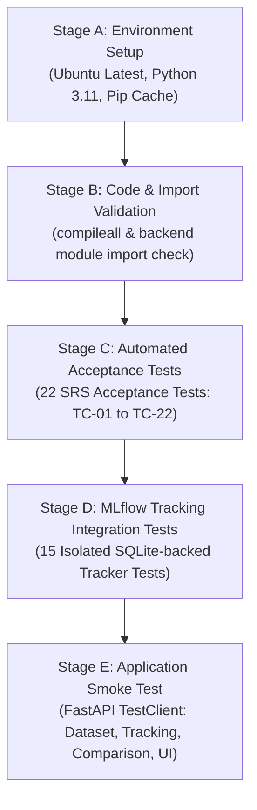
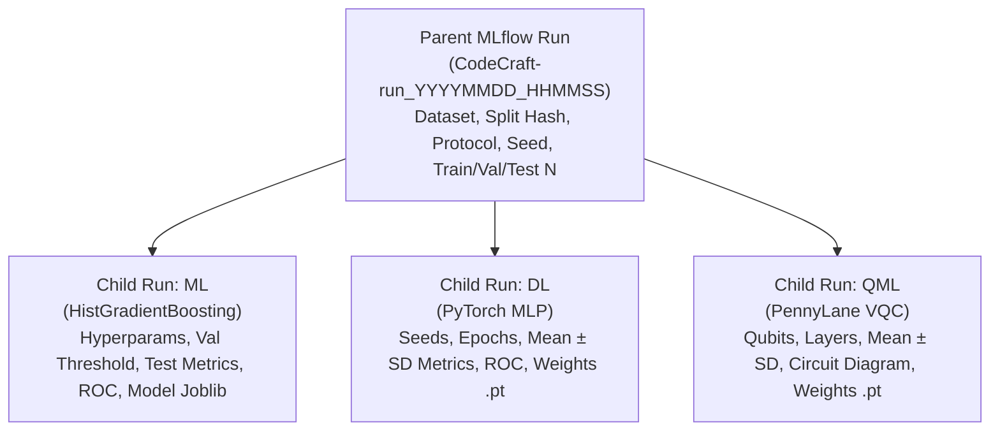

# CodeCraft MLOps Guide: GitHub Actions & MLflow Integration

This operational and technical guide documents the integration of **GitHub Actions Continuous Integration (CI)** and **MLflow Automated Experiment Tracking** into the **CodeCraft Early Metabolic Risk Detection Platform**.

---

## 1. Why GitHub Actions and MLflow Were Introduced

### GitHub Actions CI
Prior to this integration, testing and regression checks were performed solely on developer workstations. As the CodeCraft platform grew to encompass three disparate modeling paradigms—Classical ML (`HistGradientBoosting`), Deep Learning (`PyTorch Feed-Forward MLP`), and Quantum ML (`PennyLane Variational Quantum Classifier on default.qubit`)—automated continuous integration was required to guarantee:
- **Reproducible build verification** on clean standard runner environments (Ubuntu, Python 3.11).
- **Automated regression gating**: Ensuring that the 22 acceptance tests (TC-01 through TC-22) mapped to the SRS never regress upon commit or pull request.
- **Immediate code syntax and compilation validation**: Guarding against syntax errors, import regressions, and missing dependencies before code merges into `main`.
- **Application smoke testing**: Validating that FastAPI endpoints and client integrations remain operational.

### MLflow Automated Experiment Tracking
While the platform previously recorded execution runs in a local JSON `ResultsStore`, MLflow provides enterprise-grade MLOps capabilities:
- **Hierarchical Experiment Tracking**: Structuring user-initiated benchmark requests into a canonical parent run with linked nested child runs for each model family (`ml`, `dl`, `qml`).
- **Dynamic Parameter & Hyperparameter Capture**: Automatically extracting adapter configurations from `.describe()` calls rather than relying on hardcoded parameter registries.
- **Audit-grade Metric Tracking**: Preserving fine-grained validation thresholds, decision metrics, bootstrap confidence intervals, and multi-seed variation (mean and standard deviation).
- **Reproducible Model & Metadata Artifacts**: Saving model weights, pipeline definitions, ROC curve coordinates, and PennyLane quantum circuit diagrams.
- **Visual Exploration & Governance**: Providing an interactive local or remote web UI for comparative visualization without compromising raw health data privacy.

---

## 2. GitHub Actions CI Architecture

The continuous integration workflow is defined in [`.github/workflows/ci.yml`](../.github/workflows/ci.yml).

### Workflow Triggers
The workflow triggers automatically upon:
1. `push` events targeting the `main` branch.
2. `pull_request` events targeting the `main` branch.
3. `workflow_dispatch` (manual execution via GitHub Web UI or `gh workflow run`).

### Concurrency and Timeout Safeguards
- **Concurrency control**: Cancels in-progress workflow runs for the same branch (`cancel-in-progress: true`), preventing runner resource contention.
- **Timeout limit**: Capped at `15 minutes` to prevent stalled background processes or unconstrained quantum simulations from exhausting CI credits.

### Security and Permission Model
- **Minimum Token Privileges**: Explicitly constrained to `permissions: { contents: read }`.
- **No Secret Exposure**: CI does not access or require production secrets, cloud API keys, or private medical databases.
- **Sandbox Boundary**: CI cannot push commits to GitHub, cannot deploy external containers, and runs in an isolated runner.

### CI Stages Overview



1. **Stage A — Environment & Checkout**:
   - Checks out the repository using `actions/checkout@v4`.
   - Provisions Python 3.11 using `actions/setup-python@v5` with native pip caching.
   - Installs dependencies from `requirements.txt` using the fast CPU PyTorch wheel mirror to maintain fast, reproducible CI execution without CUDA overhead.

2. **Stage B — Code Validation**:
   - Executes `python -m compileall -q backend tests` to guarantee syntax validity across all packages.
   - Executes an explicit import verification script across `backend.config`, `backend.models.*`, `backend.orchestration`, `backend.tracking`, and `backend.api.app`.

3. **Stage C — Automated Acceptance Tests**:
   - Executes `python -m pytest -v tests/test_all_requirements.py`.
   - Validates all 22 acceptance tests (TC-01 through TC-22). Tests cannot be skipped or muted.

4. **Stage D — MLflow Integration Tests**:
   - Executes `python -m pytest -v tests/test_mlflow_tracking.py`.
   - Operates against a temporary local SQLite database and local temporary artifact directory. Does not require internet connectivity or cloud credentials.

5. **Stage E — Application Smoke Test**:
   - Executes automated requests through Starlette's `TestClient` verifying `/api/dataset`, `/api/tracking/status`, `/api/comparison?runId=reference_baseline`, and `/`.

---

## 3. How to Inspect Failed CI Workflows

If a GitHub Actions CI workflow run fails:

1. **Via GitHub Web UI**:
   - Navigate to `https://github.com/PES1UG24AM004/SE-Mini-Project/actions`.
   - Click on the failing workflow run.
   - Expand the failed stage step (e.g. `Stage C — Run 22 Acceptance Tests` or `Stage D — Run MLflow Experiment Tracking Tests`).
   - Inspect the captured stdout, stderr, and failure stack trace.

2. **Via GitHub CLI (`gh`)**:
   ```bash
   # List recent workflow runs
   gh run list --workflow=ci.yml

   # View details of the latest run
   gh run view

   # View failed step logs directly in terminal
   gh run view --log-failed
   ```

---

## 4. MLflow Experiment Tracking Architecture

The tracking architecture is implemented in [`backend/tracking/mlflow_tracker.py`](../backend/tracking/mlflow_tracker.py) and seamlessly integrated into the asynchronous orchestrator in [`backend/orchestration/orchestrator.py`](../backend/orchestration/orchestrator.py).

### Canonical Experiment Hierarchy

All runs are organized under a single canonical experiment:
- **Experiment Name**: `CodeCraft-Metabolic-Risk-Benchmark`



### 1. Parent Run (Execution-Level)
Created inside the background worker thread when a training execution begins:
- **Tags**: `app_run_id`, `application="CodeCraft"`, `app_version="1.0.0"`, `git_commit`, `python_version`, `dataset_version`, `split_hash`, `single_seed_mode`, `ranking_metric`.
- **Parameters**: `dataset_version`, `split_hash`, `split_protocol`, `initial_seed`, `models_to_run`, `n_selected_features`, `raw_features`, `transformed_dimension`, `n_train`, `n_val`, `n_test`, `ranking_metric`.
- **Artifacts**: `experiment_summary.json` containing run completion metadata, timestamp, and status.

### 2. Child Runs (Model-Family Level)
Linked hierarchically using MLflow's standard nested tag `mlflow.parentRunId = parent_run_id`:
- **Classical ML (`ml`)**: Single-seed benchmark run.
- **Deep Learning (`dl`)**: Multi-seed (seeds 42–46) or single-seed run.
- **Quantum ML (`qml`)**: Multi-seed (seeds 42–46) or single-seed run on PennyLane `default.qubit`.

---

## 5. Tracked Parameters and Metrics

### Parameters Tracked Per Model Family
Parameters are extracted dynamically from each adapter's `.describe()` output:

| Model Family | Tracked Parameters |
| :--- | :--- |
| **Classical ML** | `model_name`, `backend`, `seed`, `feature_set`, `n_features`, `n_transformed_features`, `hp_learning_rate`, `hp_max_iter`, `hp_max_leaf_nodes`, `hp_class_weight`, `hp_early_stopping` |
| **Deep Learning** | `model_name`, `backend`, `seed`, `hp_hidden_layers`, `hp_dropout`, `hp_lr`, `hp_weight_decay`, `hp_batch_size`, `hp_max_epochs`, `hp_patience`, `hp_optimizer`, `hp_loss`, `hp_early_stopping` |
| **Quantum ML** | `model_name`, `backend`, `seed`, `n_qubits`, `n_trainable_params`, `hp_ansatz`, `hp_embedding`, `hp_n_layers`, `hp_learning_rate`, `hp_epochs`, `hp_batch_size`, `hp_subsample_size`, `hp_classical_readout`, `hp_shots` |

### Metrics Tracked Per Model Run
Metrics conform exactly to the project's evaluation protocol:

| Metric Category | Metrics Logged |
| :--- | :--- |
| **Decision Threshold** | `decision_threshold` (Validation threshold maximizing sensitivity at specificity $\ge 0.70$) |
| **Primary Test Metrics** | `accuracy`, `precision`, `sensitivity`, `specificity`, `f1`, `roc_auc` |
| **Baseline 0.5 Metrics**| `threshold_0.5_accuracy`, `threshold_0.5_precision`, `threshold_0.5_sensitivity`, `threshold_0.5_specificity`, `threshold_0.5_f1`, `threshold_0.5_roc_auc` |
| **Confusion Matrix** | `confusion_tn`, `confusion_fp`, `confusion_fn`, `confusion_tp` |
| **Confidence Intervals** | `ci95_accuracy_low/high`, `ci95_sensitivity_low/high`, `ci95_specificity_low/high`, `ci95_f1_low/high`, `ci95_roc_auc_low/high` |
| **Multi-Seed Summaries**| `sensitivity_mean`, `sensitivity_sd`, `specificity_mean`, `specificity_sd`, `f1_mean`, `f1_sd`, `threshold_mean`, `threshold_sd` |
| **Individual Seeds** | `seed_<S>_sensitivity`, `seed_<S>_specificity`, `seed_<S>_threshold`, etc. |
| **Computational Footprint**| `runtime_sec`, `peak_memory_mb` |

---

## 6. Artifact Organization & Model Reloadability

Every completed model family saves structured artifacts to MLflow:

```
child_run_artifacts/
├── model_metadata.json         # Runtime info, peak memory, Python/lib versions, limitations
├── hyperparameters.json        # Complete adapter hyperparameter dictionary
├── evaluation_metrics.json     # All evaluated metrics, CI bounds, and confusion matrix
├── roc_curve.json              # Evaluated FPR and TPR coordinate arrays
├── circuit_diagram.txt         # ASCII PennyLane quantum circuit diagram (QML only)
└── model/                      # Serialized model artifacts
    ├── classifier.joblib       # Serialized HistGradientBoostingClassifier (ML)
    ├── preprocessor_meta.json  # Feature ordering & transformation metadata (ML)
    ├── weights.pt              # PyTorch MLP state_dict (DL)
    ├── architecture.json       # Layer sizing, dropout rate, and dimensions (DL)
    ├── variational_weights.pt  # PennyLane tensor weights, scale, and bias (QML)
    └── qml_config.json         # Circuit layer count, ansatz, and wire count (QML)
```

### Model Reloadability Verification
Artifact logging automatically performs a verification check upon serialization:
- For ML: `joblib.load()` is executed and verified to retain `.predict_proba`.
- For DL: `torch.load(..., weights_only=True)` is verified to successfully reconstruct the state dictionary.
- For QML: `torch.load()` is verified to restore variational weight tensors and readout scale/bias.

---

## 7. Critical Data Privacy & Non-Leakage Safeguards

Under no circumstances does CodeCraft leak sensitive health or participant data into MLflow:

> [!CAUTION]
> **Strict Data Privacy Guardrail**
> 1. **No Participant Records**: Raw NHANES participant records, demographic rows, or uploaded user CSVs are never saved as MLflow artifacts or tags.
> 2. **No Participant Identifiers**: Primary survey keys (`SEQN`), survey design variables (`SDMVPSU`, `SDMVSTRA`), and participant names are forbidden from parameters, metrics, and tags.
> 3. **No Individual Predictions**: Only aggregate performance statistics (rates, means, SDs, CIs, confusion counts) are logged.
> 4. **No Datasets in Artifacts**: Neither `train.csv`, `validation.csv`, `test.csv`, nor user uploads are uploaded to MLflow artifact storage.

This guardrail is verified automatically in `tests/test_mlflow_tracking.py::test_13_privacy_no_dataset_leakage`.

---

## 8. Fault Isolation & Reliability Architecture

MLflow is designed as an **observability layer**, not a brittle dependency that could crash model training:

1. **Server Offline Resilience**: If the MLflow server is offline, down, or unreachable, an immediate pre-flight socket check (timeout: 0.3s) detects the condition. It marks tracking as unavailable and logs a warning, allowing the training pipeline to proceed uninterrupted.
2. **Model Failure Isolation**: If a model family (e.g., Quantum ML) encounters an out-of-memory or convergence error:
   - The error is isolated to that model family.
   - The MLflow child run is terminated with status `FAILED` and tagged with the safe error message.
   - Successful models (`ml` and `dl`) are preserved in MLflow and in `ResultsStore`.
   - The parent MLflow run terminates with status `FINISHED` and tag `completion_status="partial_completion"`.
3. **ResultsStore Independence**: The local atomic JSON store (`results/runs/<run_id>.json`) remains the application's canonical persistence layer. It stores the associated MLflow parent and child run IDs for two-way traceability.

---

## 9. Local Setup & Windows Execution Instructions

### A. Environment Configuration
Copy the provided environment template:
```powershell
Copy-Item .env.example .env
```

Ensure `.env` contains:
```ini
MLFLOW_ENABLED=true
MLFLOW_TRACKING_URI=http://127.0.0.1:5000
MLFLOW_EXPERIMENT_NAME=CodeCraft-Metabolic-Risk-Benchmark
```

### B. Starting the Local MLflow Tracking Server
Use the dedicated PowerShell script in `scripts/start_mlflow.ps1`:
```powershell
# From project root in PowerShell:
.\scripts\start_mlflow.ps1
```

The script will:
- Verify that MLflow is installed in the active environment.
- Bind strictly to localhost (`127.0.0.1:5000`).
- Use SQLite backend storage (`sqlite:///mlflow.db`) and local artifacts (`./mlartifacts`).
- Print the accessible web UI link: `http://127.0.0.1:5000`.

### C. Starting the CodeCraft Application Server
In a separate terminal:
```powershell
.\.venv\Scripts\python.exe -m uvicorn backend.api.app:app --host 127.0.0.1 --port 8000 --reload
```

### D. Verifying Tracking Status
Query the REST API tracking status endpoint:
```powershell
Invoke-RestMethod -Uri "http://127.0.0.1:8000/api/tracking/status" | ConvertTo-Json
```
Response when server is running:
```json
{
  "enabled": true,
  "available": true,
  "tracking_uri": "http://127.0.0.1:5000",
  "experiment_name": "CodeCraft-Metabolic-Risk-Benchmark",
  "active_experiment_id": "1",
  "ui_url": "http://127.0.0.1:5000",
  "error": null
}
```

---

## 10. Remote Tracking Server Configuration

To point CodeCraft to a centralized, secured remote MLflow tracking server (e.g., team server on AWS, Azure, GCP, or Databricks):

1. Update your local `.env`:
   ```ini
   MLFLOW_ENABLED=true
   MLFLOW_TRACKING_URI=https://mlflow.example.internal:443
   MLFLOW_EXPERIMENT_NAME=CodeCraft-Metabolic-Risk-Benchmark
   MLFLOW_TRACKING_USERNAME=team_mlops_user
   MLFLOW_TRACKING_PASSWORD=your_secure_password_or_token
   ```
2. The application will authenticate automatically using basic authentication or bearer tokens.
3. Credentials will **never** appear in the web UI, API endpoints, logs, or exported reports.

---

## 11. Troubleshooting

| Symptom | Cause | Solution |
| :--- | :--- | :--- |
| `available: false` at `/api/tracking/status` | MLflow server is not running on port 5000 | Launch `.\scripts\start_mlflow.ps1` in a separate terminal. |
| Model training works but no runs in MLflow | `MLFLOW_ENABLED=false` in environment | Set `MLFLOW_ENABLED=true` in `.env` or environment variables. |
| Port 5000 is occupied by another process | Port conflict on Windows | Run `start_mlflow.ps1 -Port 5050` and set `MLFLOW_TRACKING_URI=http://127.0.0.1:5050`. |
| SQLite database locked error | Multiple processes writing simultaneously | Use a dedicated SQLite connection or set WAL mode (`PRAGMA journal_mode=WAL;`). |

---

## 12. Current Limitations

1. **Quantum Circuit Simulation Speed**: PennyLane VQC simulations execute on classical CPU (`default.qubit`). Full 5-seed training across 15 epochs requires ~30–45 seconds per seed. In CI and development environments, single-seed mode or subsampling is recommended.
2. **Local Artifact Storage**: When running the default localhost SQLite server, artifacts are stored in `./mlartifacts` on the local filesystem. For distributed multi-node teams, an S3/GCS bucket artifact root should be configured.
